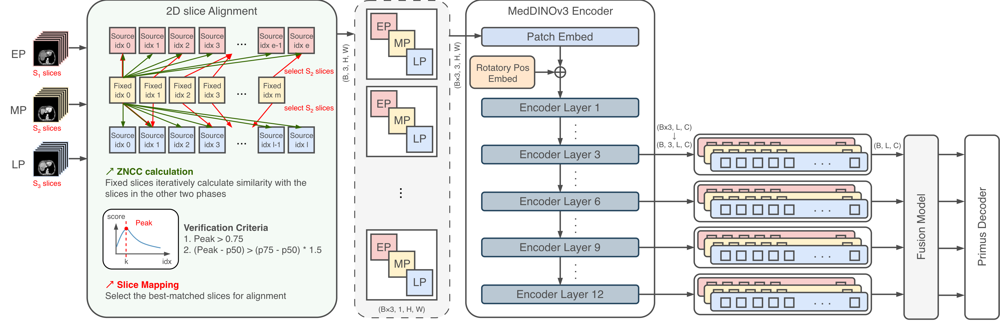

# DynoDINO

**Harnessing Dynamic Latent Information from DINO Features for Multi-Phase Medical Image Segmentation**

[](https://arxiv.org/abs/2607.29568)
[](https://www.python.org/)
[](https://pytorch.org/)

DynoDINO is a multi-phase medical image segmentation framework that models dynamic contrast information across multi-phase contrast-enhanced computed tomography (CECT) using DINO features.

## Overview

Multi-phase CECT provides complementary information across different contrast phases. However, inter-phase spatial misalignment, different slice sampling, missing phases, and intensity variations can make effective feature fusion challenging.

DynoDINO addresses these challenges by aligning multi-phase images and explicitly modeling contrast dynamics in the feature space.



**Figure 1.** Overview of the proposed DynoDINO framework.

### Key Components

- **FFT-based ZNCC Alignment**  
  FFT-accelerated Zero-mean Normalized Cross-Correlation (ZNCC) establishes spatial correspondence across CT phases.

- **MedDINOv3 Backbone**  
  MedDINOv3 provides multi-scale visual representations from multi-phase CECT images.

- **Mix-Attention**  
  Cross-phase feature interactions are modeled through Mix-Attention.

- **Difference-based Residual Learning**  
  Feature differences between phases are explicitly modeled to capture dynamic contrast-enhancement patterns.

- **Adaptive Gating**  
  Difference features are selectively weighted to suppress the influence of residual inter-phase misalignment.

The framework also supports incomplete multi-phase inputs within the same architecture.

## Paper

**DynoDINO: Harnessing Dynamic Latent Information from DINO Features for Multi-Phase Medical Image Segmentation**

- **arXiv:** [https://arxiv.org/abs/2607.29568](https://arxiv.org/abs/2607.29568)
- **HTML:** [https://arxiv.org/html/2607.29568v1](https://arxiv.org/html/2607.29568v1)

**Authors:** Yu-Pu Hsu, Jen-Jee Chen, and Yu-Chee Tseng

## Installation

### Requirements

- Python 3.11
- PyTorch 2.5.1
- CUDA-enabled GPU
- nnU-Net v2
- `uv`

### Clone the Repository

Clone DynoDINO together with its MedDINOv3 submodule:

```bash
git clone --recurse-submodules https://github.com/yupu891101/DynoDINO.git
cd DynoDINO
```

If the repository has already been cloned without submodules:

```bash
git submodule update --init --recursive
```

### Create the Environment

Install [`uv`](https://docs.astral.sh/uv/) if necessary.

Then install the project dependencies:

```bash
uv sync
```

Verify the Python environment:

```bash
uv run python --version
```

The expected Python version is Python 3.11.x.

## Pretrained Model

DynoDINO uses **MedDINOv3 ViT-B/16 pretrained on CT-3M** as its visual backbone.

| Backbone | Pretraining Dataset | Download |
|---|---|---|
| ViT-B/16 | CT-3M (3.87M CT slices) | [Google Drive](https://drive.google.com/file/d/1_MgctUnIIFcQJCVOhkcs84qq92hlqXVA/view?usp=sharing) / [Hugging Face](https://huggingface.co/ricklisz123/MedDINOv3-ViTB-16-CT-3M) |

Download the pretrained checkpoint and place it at:

```text
checkpoints/
└── meddinov3.pth
```

The pretrained weights are **not included** in this repository.

## Dataset Preparation

DynoDINO provides preprocessing pipelines for the following datasets:

| Dataset Type | Dataset | nnU-Net ID |
|---|---|---:|
| `lits` | LiTS / MSD Task03 Liver | 3 |
| `cect` | CECT | 500 |
| `wawtace` | WAW-TACE | 501 |

The corresponding preprocessing implementations are located in:

```text
data_preprocessing/
├── msd_base_dataset.py
├── cect_dataset.py
├── waw_tace_dataset.py
└── prepare_nnunet_dataset.py
```

Initializing the corresponding dataset class performs the required dataset download and preprocessing.

The processed data is subsequently converted into the nnU-Net dataset format by:

```text
data_preprocessing/prepare_nnunet_dataset.py
```

### nnU-Net Environment Variables

Before preparing the nnU-Net dataset, configure the required nnU-Net environment variables:

```bash
export nnUNet_raw=<PATH_TO_NNUNET_RAW>
export nnUNet_preprocessed=<PATH_TO_NNUNET_PREPROCESSED>
export nnUNet_results=<PATH_TO_NNUNET_RESULTS>
```

These variables specify:

| Variable | Purpose |
|---|---|
| `nnUNet_raw` | Raw nnU-Net datasets |
| `nnUNet_preprocessed` | nnU-Net preprocessed datasets |
| `nnUNet_results` | Training results |

For more information, refer to the [nnU-Net repository](https://github.com/MIC-DKFZ/nnUNet).

## Quick Start

After completing the installation, configuring the nnU-Net environment variables, and downloading the MedDINOv3 checkpoint, the complete pipeline can be executed with:

```bash
uv run python main.py all --type lits
```

The `--type` argument accepts:

```text
lits
cect
wawtace
```

The nnU-Net dataset ID is automatically determined from the selected dataset type.

The default trainer is:

```text
dynodino_base_primus_multiscale_Trainer
```

A different nnU-Net trainer can be selected with `--trainer`:

```bash
uv run python main.py all \
    --type lits \
    --trainer <YOUR_TRAINER>
```

## Pipeline Stages

The complete pipeline can also be executed step by step.

### 1. Dataset Download and Preprocessing

For example, to prepare LiTS:

```bash
uv run python main.py prepare --type lits
```

The `--type` argument can also be set to `cect` or `wawtace`.

By default, preprocessed data is stored under:

```text
../DynoDINO_preprocessed_data
```

A custom location can be provided with `--data-root`:

```bash
uv run python main.py prepare \
    --type lits \
    --data-root /path/to/data
```

### 2. Prepare the nnU-Net Dataset

After dataset preprocessing:

```bash
uv run python main.py dataset --type lits
```

This runs the dataset conversion implemented in:

```text
data_preprocessing/prepare_nnunet_dataset.py
```

The default input directory is:

```text
../DynoDINO_preprocessed_data
```

A custom directory can be specified with `--preprocessed-data-root`:

```bash
uv run python main.py dataset \
    --type lits \
    --preprocessed-data-root /path/to/preprocessed/data
```

By default, `prepare_nnunet_dataset.py` uses the `nnUNet_raw` environment variable as the output root.

A custom nnU-Net raw directory can be provided explicitly:

```bash
uv run python main.py dataset \
    --type lits \
    --nnunet-raw-root /path/to/nnUNet_raw
```

### 3. nnU-Net Planning and Preprocessing

To preprocess a specific nnU-Net dataset:

```bash
uv run python main.py preprocess --dataset-id 3
```

The command internally runs:

```bash
nnUNetv2_plan_and_preprocess -d 3 --verify_dataset_integrity
```

The dataset ID can be changed to any valid nnU-Net dataset ID.

For the datasets provided by DynoDINO:

```text
LiTS / MSD       → 3
CECT             → 500
WAW-TACE         → 501
```

### 4. Training

Training is controlled through the dataset ID and trainer name.

For example:

```bash
uv run python main.py train \
    --dataset-id 3 \
    --trainer dynodino_base_primus_multiscale_Trainer
```

The `--trainer` argument is optional. If omitted, DynoDINO uses:

```text
dynodino_base_primus_multiscale_Trainer
```

The command internally runs the nnU-Net 2D configuration using all folds and enables NPZ output.

A different trainer can be specified with:

```bash
uv run python main.py train \
    --dataset-id 3 \
    --trainer <YOUR_TRAINER>
```

## Custom Data Paths

The standard setup uses:

```text
../DynoDINO_preprocessed_data
```

as the default directory for dataset preprocessing.

The path can be overridden independently for different stages.

### Dataset Preprocessing

```bash
uv run python main.py prepare \
    --type lits \
    --data-root /path/to/data
```

### nnU-Net Dataset Conversion

```bash
uv run python main.py dataset \
    --type lits \
    --preprocessed-data-root /path/to/data
```

### Complete Pipeline

```bash
uv run python main.py all \
    --type lits \
    --data-root /path/to/data \
    --preprocessed-data-root /path/to/data
```

The `--nnunet-raw-root` option can additionally be used to override the `nnUNet_raw` environment variable for dataset conversion.

## Repository Structure

```text
DynoDINO/
├── assets/
│   └── overall_arch.png
│
├── checkpoints/
│   └── meddinov3.pth
│
├── data_preprocessing/
│   ├── msd_base_dataset.py
│   ├── cect_dataset.py
│   ├── waw_tace_dataset.py
│   └── prepare_nnunet_dataset.py
│
├── MedDINOv3/
│
├── main.py
├── pyproject.toml
├── uv.lock
└── README.md
```

## MedDINOv3

DynoDINO uses a customized version of MedDINOv3 maintained in the project's fork.

MedDINOv3 is included as a Git submodule. The DynoDINO repository records the specific MedDINOv3 commit used by the project.

When cloning DynoDINO, use:

```bash
git clone --recurse-submodules https://github.com/yupu891101/DynoDINO.git
```

to initialize the submodule automatically.

### Updating the MedDINOv3 Submodule

If changes to the MedDINOv3 fork are required:

```bash
cd MedDINOv3

git add .
git commit -m "Update MedDINOv3 for DynoDINO"
git push

cd ..

git add MedDINOv3
git commit -m "Update MedDINOv3 submodule"
git push
```

The DynoDINO repository should then record the updated MedDINOv3 commit.

## Reproducibility

For reproducible experiments, the following project components should be version controlled:

- DynoDINO source code
- Dataset preprocessing scripts
- `main.py`
- `pyproject.toml`
- `uv.lock`
- MedDINOv3 submodule reference
- Training configuration

The following data should generally **not** be committed to the repository:

- Raw datasets
- Preprocessed datasets
- nnU-Net generated datasets
- Pretrained model checkpoints
- Training outputs

The exact MedDINOv3 implementation is determined by the Git commit referenced by the submodule.

## Citation

If you find DynoDINO useful in your research, please cite:

```bibtex
@article{hsu2026dynodino,
  title={DynoDINO: Harnessing Dynamic Latent Information from DINO Features for Multi-Phase Medical Image Segmentation},
  author={Hsu, Yu-Pu and Chen, Jen-Jee and Tseng, Yu-Chee},
  journal={arXiv preprint arXiv:2607.29568},
  year={2026}
}
```

## References

- [DynoDINO](https://arxiv.org/abs/2607.29568)
- [MedDINOv3](https://huggingface.co/ricklisz123/MedDINOv3-ViTB-16-CT-3M)
- [nnU-Net](https://github.com/MIC-DKFZ/nnUNet)
- [uv](https://docs.astral.sh/uv/)